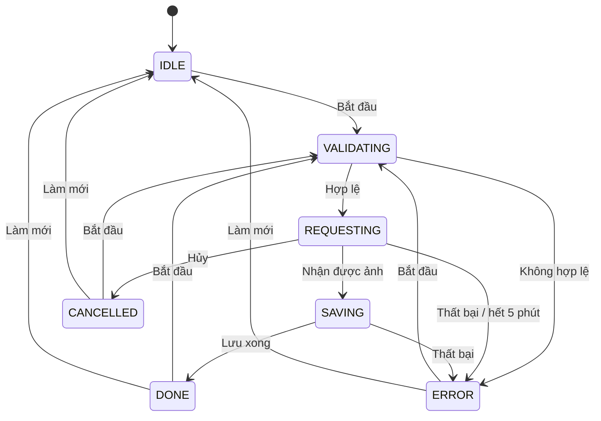

# AI Image Saver

Tiện ích mở rộng Chrome (Manifest V3) giúp **tạo ảnh bằng AI từ một đoạn mô tả và tự động lưu vào thư mục Tải xuống**. Ảnh được tạo bởi mô hình `recraft/recraft-v4.1-flash-v2` thông qua API của [Beeknoee](https://platform.beeknoee.com).

Dự án viết bằng JavaScript thuần, không dùng framework, không cần cài đặt thư viện hay biên dịch.

## Tính năng

- Nhập mô tả ảnh trong popup, chọn tỉ lệ khung hình rồi bấm **Tạo và lưu**.
- Hỗ trợ 7 tỉ lệ khung hình: `1:1`, `16:9`, `4:3`, `3:2`, `9:16`, `3:4`, `2:3`.
- Theo dõi tiến trình qua 4 bước: **Kiểm tra → Tạo ảnh → Lưu tệp → Xong**; hiển thị thời gian đã chờ và nút **Hủy** khi đang tạo ảnh.
- Xem trước ảnh ngay trong popup, kèm đường dẫn tệp đã lưu và chi phí (nếu API trả về).
- Tự động lưu ảnh vào thư mục con trong Tải xuống (mặc định `AI-Images`), tên tệp lấy từ mô tả.
- **Lịch sử** tối đa 50 ảnh gần nhất: ảnh thu nhỏ, thời gian, tỉ lệ, chi phí; có tìm kiếm theo mô tả, nút **Dùng lại**, **Xóa**, **Xóa tất cả lịch sử** và bấm vào ảnh thu nhỏ để mở tệp trong thư mục.
- **Menu chuột phải**: bôi đen văn bản trên trang web, chọn *Tạo ảnh AI từ đoạn đã chọn* để tạo ảnh ngay (tối đa 4000 ký tự).
- Huy hiệu (badge) trên biểu tượng extension cho biết trạng thái: `…` đang xử lý, `✓` hoàn tất, `!` lỗi.
- Tự lưu nháp mô tả và tỉ lệ khung hình, mở lại popup vẫn còn.
- Giao diện popup có chế độ tối.

## Yêu cầu

- Trình duyệt Chromium (Google Chrome, Microsoft Edge, Brave…) phiên bản **110 trở lên**.
- Tài khoản Beeknoee và **API key** (dạng `sk-bee-...`).

## Cài đặt

Extension chưa có trên Chrome Web Store nên được nạp ở chế độ nhà phát triển:

1. Tải mã nguồn về và giải nén (hoặc `git clone`).
2. Mở `chrome://extensions`.
3. Bật **Developer mode** (Chế độ dành cho nhà phát triển) ở góc trên bên phải.
4. Bấm **Load unpacked** (Tải tiện ích đã giải nén) và chọn thư mục `ai-image-saver` (thư mục chứa `manifest.json`).
5. Ghim biểu tượng extension lên thanh công cụ để mở popup nhanh.

## Sử dụng

1. Mở popup, mở mục **Cài đặt API (Beeknoee)**, nhập **API key** rồi bấm **Lưu cài đặt**. Lần đầu chưa có khóa, mục này tự mở.
2. Nhập mô tả ảnh, ví dụ: `chợ nổi buổi sáng trên sông Hậu, màu nước`.
3. Chọn tỉ lệ khung hình và bấm **Tạo và lưu**.
4. Chờ ảnh hiện ở phần xem trước. Tệp được lưu tại `Tải xuống/<thư mục>/<tên>-<thời gian>.<đuôi>`.
5. Bấm **Tạo ảnh khác** để làm mới và tạo ảnh tiếp.

### Cài đặt

| Mục | Mặc định | Ý nghĩa |
|---|---|---|
| API key | (trống) | Khóa API Beeknoee, hiển thị dạng mật khẩu |
| Base URL | `https://platform.beeknoee.com` | Địa chỉ máy chủ API; bắt buộc dùng `https` |
| Model | `recraft/recraft-v4.1-flash-v2` | Mô hình tạo ảnh |
| Thư mục lưu | `AI-Images` | Thư mục con trong Tải xuống; chỉ giữ chữ, số, `_`, `-` và khoảng trắng |

Nếu đổi Base URL sang một tên miền khác Beeknoee, Chrome sẽ hỏi cấp quyền truy cập tên miền đó khi bấm **Lưu cài đặt** (quyền tùy chọn `optional_host_permissions`).

### Quy tắc đặt tên tệp

```
<thư-mục>/<mô-tả-không-dấu-tối-đa-40-ký-tự>-<YYYYMMDD-HHMMSS>.<png|jpg|webp|svg>
```

Mô tả được chuyển sang không dấu và nối bằng dấu gạch ngang. Nếu trùng tên, Chrome tự thêm số (`conflictAction: uniquify`). Đuôi tệp suy ra từ kiểu nội dung của ảnh nhận được.

## Cách hoạt động

Toàn bộ logic nằm trong service worker `background.js`; popup chỉ hiển thị trạng thái và gửi lệnh `START`, `CANCEL`, `RESET`. Hai phần trao đổi qua `chrome.runtime.sendMessage` và `chrome.storage`.

Luồng xử lý khi tạo ảnh:

1. **Kiểm tra đầu vào**: có API key và model; mô tả dài 3–4000 ký tự; tỉ lệ hợp lệ; Base URL dùng `https` và đã được cấp quyền.
2. **Gửi yêu cầu** `POST {baseUrl}/v1/image/generations` với `model`, `prompt`, `aspect_ratio` và header `Authorization: Bearer <API key>`.
3. Nếu máy chủ trả trạng thái `PROCESSING`, extension **hỏi lại mỗi 5 giây** qua `GET {baseUrl}/v1/image/generations/{job_id}` cho tới khi `COMPLETED` hoặc `FAILED`. Tối đa chờ **5 phút**.
4. **Tải ảnh** từ `b64_json` hoặc từ đường dẫn `url` trong phản hồi.
5. **Lưu tệp** bằng `chrome.downloads`, chờ tải xong, rồi ghi một mục vào lịch sử (kèm ảnh thu nhỏ JPEG khoảng 160 px).

Trong lúc chờ, service worker gọi `chrome.runtime.getPlatformInfo()` mỗi 20 giây để không bị Chrome tạm dừng. Nếu service worker bị khởi động lại giữa chừng, tiến trình dở dang được đánh dấu là lỗi "Tiến trình bị gián đoạn" để người dùng thử lại.

### Máy trạng thái



Mọi chuyển trạng thái đi qua hàm `transition()`; sự kiện không hợp lệ ở trạng thái hiện tại bị từ chối. Sơ đồ cũng có trong tệp `state-diagram.mermaid`.

## Cấu trúc dự án

```
ai-image-saver/
├── manifest.json          # khai báo MV3, quyền, service worker
├── background.js          # service worker: máy trạng thái, gọi API, lưu tệp, lịch sử, menu chuột phải
├── popup.html             # khung giao diện popup
├── popup.css              # kiểu giao diện (có chế độ tối)
├── popup.js               # điều khiển popup: tiến trình, cài đặt, lịch sử
└── state-diagram.mermaid  # sơ đồ máy trạng thái
```

## Quyền sử dụng

| Quyền | Dùng để |
|---|---|
| `storage` | Lưu cài đặt, nháp, lịch sử (`local`) và trạng thái tiến trình, ảnh xem trước (`session`) |
| `downloads` | Lưu ảnh vào Tải xuống, kiểm tra tệp còn tồn tại, mở tệp trong thư mục |
| `contextMenus` | Mục menu chuột phải "Tạo ảnh AI từ đoạn đã chọn" |
| `host_permissions`: `https://platform.beeknoee.com/*` | Gọi API Beeknoee |
| `optional_host_permissions`: `https://*/*` | Chỉ xin khi người dùng đổi Base URL sang tên miền khác |

## Dữ liệu và bảo mật

- API key được lưu trong `chrome.storage.local` của trình duyệt, **không mã hóa**. Không dùng extension này trên máy dùng chung.
- Extension chỉ gửi mô tả ảnh và API key tới Base URL bạn cấu hình; không có máy chủ trung gian nào khác.
- Lịch sử gồm mô tả, thời gian, đường dẫn tệp và ảnh thu nhỏ, lưu cục bộ. Có thể xóa từng mục hoặc xóa tất cả trong popup. Xóa lịch sử không xóa tệp ảnh đã lưu.

## Lỗi thường gặp

| Hiện tượng | Nguyên nhân và cách xử lý |
|---|---|
| "Chưa có API key Beeknoee" | Mở **Cài đặt API**, nhập khóa và bấm **Lưu cài đặt** |
| "Mô tả ảnh quá ngắn" | Mô tả cần ít nhất 3 ký tự |
| `HTTP 401` hoặc `403` | API key sai, hết hạn hoặc không đủ quyền |
| `HTTP 429` | Gọi quá nhanh hoặc vượt giới hạn; chờ một lúc rồi thử lại |
| "Hết thời gian chờ (5 phút)" | Ảnh có thể vẫn được tạo; kiểm tra Thư viện trên Beeknoee |
| "Chưa cấp quyền truy cập ..." | Đang dùng Base URL khác Beeknoee; mở Cài đặt và bấm **Lưu cài đặt** để cấp quyền |
| "Tiến trình bị gián đoạn" | Chrome khởi động lại service worker giữa chừng; bấm tạo lại |
| Ảnh trong lịch sử báo "Không tìm thấy tệp" | Tệp đã bị xóa hoặc di chuyển khỏi thư mục Tải xuống |

## Giới hạn hiện tại

- Mỗi lần chỉ tạo **một ảnh** và chỉ chạy **một tiến trình** tại một thời điểm.
- Không tự thử lại khi gặp lỗi mạng hoặc lỗi máy chủ; người dùng bấm tạo lại.
- Chưa có bộ kiểm thử tự động trong repo.


